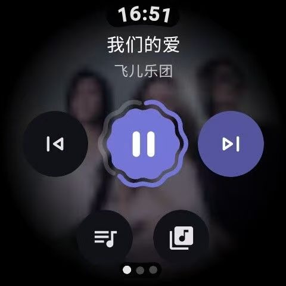
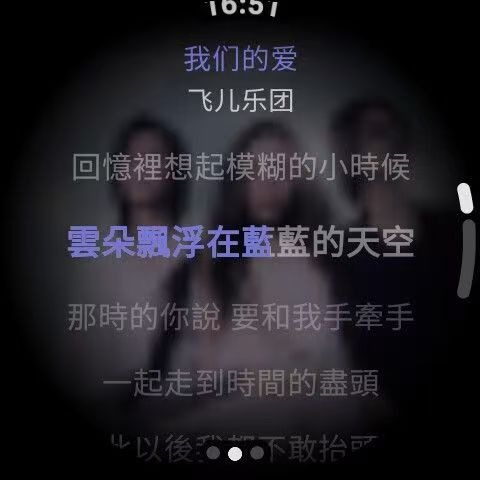
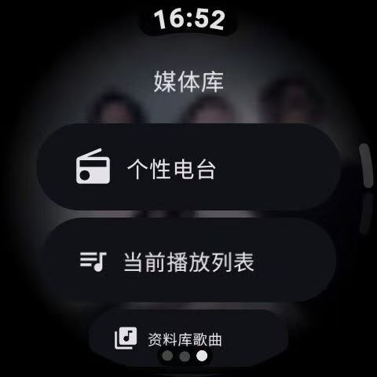

# WristAm (Wear OS Apple Music Client)

<p align="center">
  
</p>

<p align="center">
  <b>专为 Wear OS 智能手表量身打造的原生 Apple Music 客户端与动态逐字歌词播放器</b>
</p>

<p align="center">
  <a href="https://github.com/Kailian5922/WristAm/releases/latest">
    
  </a>
  
  
  
  
</p>

---

## 📖 项目简介 (Overview)

**WristAm** 是一款专为圆形/方形 Wear OS 智能手表设计的全功能 Apple Music 音乐播放器。支持手表独立联网在线点播、实时进度离线下载、个性化智能电台、全动态跨语种搜索（歌手 / 专辑 / 歌曲 / 歌词）、完整歌手主页与专辑详情浏览、睡眠定时播放，并拥有与 Apple Music 官方高度一致的**毫秒级逐字卡拉OK扫光动效**、**渐进景深模糊歌词**与**动态流光封面高斯模糊背景**。

同时附带手机端配套应用 (`:phone`)，通过 WebView 登录 Apple ID 并利用 Google Play Services Wearable 协议一键跨端同步鉴权 Token 至手表，彻底解决智能手表端输入账号繁琐的痛点。

### 📱 界面预览 (Screenshots)

<p align="center">
  
  &nbsp;&nbsp;&nbsp;&nbsp;
  
  &nbsp;&nbsp;&nbsp;&nbsp;
  
</p>

<p align="center">
  <sub><b>播放控制页</b>（Horologist 波浪播放钮、定时倒计时与表冠音量） &nbsp;|&nbsp; <b>卡拉OK逐字歌词</b>（强调色扫光、垂直正中与渐进模糊） &nbsp;|&nbsp; <b>媒体库导航</b>（个性电台、搜索与曲库）</sub>
</p>

---

## ✨ 核心特性 (Features)

### 1. 灵动逐字歌词 (Synchronized Lyrics)
- **毫秒级卡拉OK扫光**：深度解析 Apple Music 官方 TTML（Timed Text Markup Language）时轴，实现精准到音节/汉字的平滑光泽扫色渲染 (`AppleMusicKaraokeSweepText`)。
- **垂直正中对齐与渐进景深模糊**：当前播放行精准定位于表盘视口垂直中央，并按与当前行的距离向上下逐级递增高斯模糊；当手指滑动或转动表冠浏览歌词时自动解除模糊，便于清晰查看上下文。
- **弹性动效与间奏呼吸点**：当前播放行具备平滑缩放效果；音乐间奏时动态展示三点呼吸渐隐脉动动效 (`AppleMusicInterludeDots`)。
- **原生表冠惯性滚动**：歌词页采用 Wear Compose 原生 `rotaryScrollable` 绑定，支持阻尼惯性滚动与触觉反馈。
- **动态主题强调色与双语字幕**：自动跟随当前专辑封面提取 Material 3 强调色，内置 QQ 音乐歌词双引擎匹配算法，为外文歌曲自动补全高质量中文字幕。

### 2. 全动态跨语种搜索、歌手主页与专辑详情 (Search, Artists & Albums)
- **多维度统一搜索 (`SearchScreen`)**：支持按**歌名、歌手、专辑或歌词片段**检索，合并 Apple Music 目录与本地资料库匹配，结果按「**歌手 → 专辑 → 歌曲**」清晰分层展示，离线或弱网时自动兜底本地资料库。
- **全动态跨语种歌手精准匹配**：不依赖静态硬编码字典，基于 Apple Music 全球统一数字艺人 ID 按语种动态跨区（`cn` / `tw` / `us` / `jp`）批量核验官方名，并结合简繁/日语新字体/拉丁重音规范化、Apple `topResults` 跨语种实体保护与实时双语解析，支持中文名、英文名及日语原名精准搜索任意艺人。
- **完整歌手主页 (`ArtistDetailScreen`)**：无论是从搜索结果还是从播放页点击艺人名（合作曲目支持先进入 `ArtistPickerScreen` 选择艺人），均可完整加载**热门歌曲（支持显式分页加载）**、**精选专辑**、**单曲与 EP**、**歌手简介**及**相似艺人**。
- **独立专辑详情页 (`AlbumDetailScreen`)**：在歌手页或搜索页点击任意专辑/单曲打开专属专辑页面，展示专辑封面、可点击跳转歌手主页的艺人名、发行年份与曲目数，支持一键「顺序播放 / 随机播放」、单曲点播与离线下载；跨区专辑曲目自动通过 ISRC 映射至当前账号区服，确保可直接播放。

### 3. 原生手表交互与睡眠定时 (Horologist Experience & Sleep Timer)
- **动态封面流光背景**：根据当前播放歌曲的专辑原图实时取色并渲染高斯模糊流光背景，在全导航页面（含侧滑返回过渡）一致呈现无重影。
- **波浪形变播放钮与定时播放 (`SleepTimerScreen`)**：采用 Horologist 风格 10-scallop 波浪进度播放/暂停按钮；**长按播放按钮**呼出 Horologist 风格表盘时间选择器（小时/分钟滚轮与快捷时长预设），启动后在播放控制下方以不重叠胶囊实时显示倒计时，倒计时结束自动停止播放。
- **表冠旋转支持 (Rotary Input)**：播放页旋转表冠直接调节系统媒体音量；歌词页与各列表页精准响应表冠滚动。
- **个性化电台与云端双向收藏**：支持 Apple Music 智能电台（Smart Radio）无限流播放，可在播放页实时检查、添加或取消收藏歌曲并同步至个人资料库。

### 4. 流畅音频解密与实时离线下载 (Streaming, DRM & Downloads)
- **现代流媒体引擎**：基于 AndroidX Media3 (ExoPlayer) 构建的前台保活播放服务 (`WearMusicService`)。
- **CENC 与 Widevine 解密**：集成 ISO-BMFF 样本级 AES-CTR 实时解密器与 Widevine 密钥提取管线，支持 Apple Music 加密音轨流式播放。
- **全页面实时下载进度与全局提示**：支持在播放页、搜索页、歌单页、歌手页、专辑页及「已下载」页一键离线下载，实时展示下载阶段与百分比（环形进度图标 + 横向线性进度条），下载开始、完成、重复或失败均弹出全局状态提示，同时支持离线歌曲独立管理与临时缓存一键清理。

### 5. 双端协同与快捷登录 (Phone-Watch Link)
- **手机网页免密中继**：手机端配套 App (`:phone`) 提供原生 Apple ID 登录窗口，无需在手表端输入复杂密码。
- **Google Play Wearable Data Layer**：双端采用统一独立包名 `com.kailian.wristam`，登录成功后安全令牌通过实时 ACK 与 DataLayer 通道自动同步至手表。
- **硬件级安全加密**：手表端采用 AndroidX Security 提供的 `EncryptedSharedPreferences` 硬件密钥库安全存放用户 Token。

---

## 🏗️ 架构与模块划分 (Architecture)

项目采用现代化多模块 Android Gradle 架构，职责解耦清晰：

```
WristAm/
├── app/               # [Wear OS 端] 主手表应用 (MVVM + SwipeDismissableNavHost)
│   ├── wear/
│   │   ├── di/        # Application 级轻量依赖注入容器 (WearAppContainer)
│   │   ├── data/      # 鉴权、播放、单飞歌词、定时播放、收藏、离线下载、资料库、电台、艺人及专辑仓库
│   │   ├── viewmodel/ # Jetpack ViewModel 状态管理层
│   │   └── ui/        # 动态取色主题、波浪形变控件、逐字渐进模糊歌词、定时选择、搜索、歌手与专辑页
│   └── res/           # 手表专用矢量图标、Wear 能力声明、字体 (Outfit, Plus Jakarta Sans)
│
├── phone/             # [Android 手机端] 配套辅助应用
│   ├── phone/         # Apple ID 网页登录拦截器、跨端令牌中继器 (实时 ACK + 离线 DataLayer)
│   └── res/           # 手机端 Material 3 界面资源
│
├── lyrics-core/       # [歌词解析核心库]
│   └── lyrics/        # XmlPullParser TTML 与 LRC 解析器、字词级别时轴实体定义
│
└── shared/            # [共享业务与流媒体层]
    ├── apple/         # Apple Music REST API、动态跨语种艺人解析、曲库同步、搜索、缓存与下载器
    ├── cenc/          # CENC 样本级解密器 (AES-CTR)
    ├── drm/           # MediaDrm 接口与 Widevine 密钥获取器
    ├── hls/           # HLS 播放列表流解析与切片管理
    ├── mp4/           # MP4 容器解包、Box 格式解析、流清洗与 Remuxer
    ├── widevine/      # Widevine CDM 原生客户端逻辑、Proto 协议序列化
    ├── player/        # Media3 ExoPlayer 单通道可取消引擎、前台通知控制器
    └── data/          # 官方/备用歌词抓取器、双层 LRU 磁盘缓存、DES 解密
```

---

## 📦 版本更新记录 (Changelog)

- **v2.0.5**
  - 修复定时倒计时胶囊与播放按钮重合的问题，适配 `192dp` / `227dp` 双尺寸表盘；
  - 修复从播放页点击歌手仅显示资料库曲目的问题，现与搜索页一致完整展示热门歌曲、精选专辑、单曲与 EP、歌手简介及相似艺人；
  - 搜索页新增专辑搜索，结果按「歌手 → 专辑 → 歌曲」分层呈现；
  - 新增独立专辑详情页 (`AlbumDetailScreen`)，歌手页与搜索页点击专辑改为打开详情页而非直接播放；
  - 移除静态硬编码歌手字典，改用基于全球统一目录艺人 ID 的全动态跨语种精准检索。
- **v2.0.4**
  - 歌词界面升级为垂直正中对齐与按行距渐进模糊，滑动/旋钮浏览时自动解除模糊；
  - 长按播放按钮呼出 Horologist 风格睡眠定时播放选择页；
  - 搜索页支持精准匹配并展示歌手头像与名称；
  - 全界面及「已下载」页支持实时下载进度展示，并增加下载成功/失败全局提示弹窗。
- **v2.0.3**
  - 修复在线搜索去重逻辑误丢弃目录结果的问题；
  - GitHub Actions 支持通过固定 Keystore Secrets 签名发布 Release APK，实现无缝覆盖升级。
- **v2.0.2**
  - 修复导航容器内专辑封面动态模糊背景渲染问题，歌词页接入 Wear 原生 `rotaryScrollable` 惯性滚动与触觉反馈。
- **v2.0.1**
  - 双端切换为独立包名 `com.kailian.wristam` 并对齐版本号。

---

## 🛠️ 开源库引用与二次开发说明 (Credits & References)

本项目在开发过程中，吸收、借鉴并对以下优秀的开源项目与工程进行了深度二次开发与适配：

1. **[Google Horologist](https://github.com/google/horologist)**
   - **引用与借鉴**：参考了 Google 官方 Horologist 库在 Wear OS 上的媒体控件设计规范（Media UI Design Patterns）、表盘时间选择器（TimePicker）、表冠旋转联动（Rotary Scroll & Volume Handling）及曲面响应式排版理念。
   - **二次开发**：将控制盘组件、波浪进度播放钮与定时选择器原生适配至紧凑型圆形表盘，重构了契合小屏幕交互的操作热区。

2. **Apple Music 歌曲解密源码来源与思路 ([酷安动态](https://www.coolapk.com/feed/73737066?s=NjdhODM2MDAzN2JlMDhnNmFlNDg3OGN6a1670))**
   - **引用与说明**：本项目中核心的 Apple Music 音频解密管线（包括 Widevine L3 密钥获取、ISO-BMFF Common Encryption (CENC) 样本级 AES-CTR 解密以及音轨 Remuxer / Cleaner 逻辑）的底层实现思路与核心算法代码来源于酷安开发者所分享的技术方案，特此致谢。
   - **二次开发**：在原有解密逻辑基础上，进行了面向 AndroidX Media3 / ExoPlayer 的现代流媒体管道适配，实现边解密边缓冲的无缝后台播放引擎 (`PlaybackEngine` / `CencDecryptor`)。

3. **`lyrics-beta` (Apple Music API & 曲库交互参考工程)**
   - **引用与借鉴**：参考了其对 Apple Music Web API 的逆向接口规范、Widevine CDM 交互流程、曲库管理逻辑以及 QQ 音乐备用歌词接口 (`DESHelper`)。
   - **二次开发**：从原有的原型脚本重构为高度工程化的 Kotlin 协程架构，全面迁移至 Android 现代化流媒体规范；加入了针对土耳其/美区/国区/日区等跨区域请求的自动 Storefront 适配、ISRC 曲目映射与动态跨语种检索容错机制。

4. **[AndroidX Media3](https://developer.android.com/media/media3) / ExoPlayer**
   - 官方高性能音视频流媒体播放架构，驱动 HLS/MP4 解密音轨的低功耗后台连续播放。

5. **[Jetpack Compose for Wear OS](https://developer.android.com/training/wearables/compose)**
   - 全面基于声明式 UI 构建，利用 Wear Material 3 体系打造现代化、高帧率的穿戴设备体验。

6. **[Coil Compose](https://coil-kt.github.io/coil/)**
   - 极轻量的异步图片加载库，负责智能手表端的网络专辑图加载与内存自适应缓存。

7. **[Google Play Services Wearable](https://developers.google.com/android/reference/com/google/android/gms/wearable/package-summary)**
   - 手机端与手表端跨设备低功耗数据通信（DataClient / MessageClient / ChannelClient）标准实现。

---

## 🚀 安装与构建 (Install & Build)

### 直接安装（推荐）
前往 [GitHub Releases](https://github.com/Kailian5922/WristAm/releases) 下载最新版本的双端安装包：
- 手表端：`WristAm-Wear-v*.apk`（Wear OS 3.0+ / API 30+）
- 手机端：`WristAm-Phone-v*.apk`（Android 7.0+ / API 24+）

### 从源码构建

#### 环境要求
- **Android Studio**：Ladybug (2024.2.1) 或更高版本
- **JDK**：OpenJDK 17
- **Kotlin**：2.0.0+
- **Gradle**：8.5+（推荐使用项目内置 Wrapper）
- **编译 SDK (`compileSdk`)**：36

#### 构建步骤
1. 克隆代码仓库：
   ```bash
   git clone https://github.com/Kailian5922/WristAm.git
   cd WristAm
   ```
2. 配置 Android SDK 路径：
   在项目根目录下创建 `local.properties` 文件并指定 SDK 路径：
   ```properties
   sdk.dir=/path/to/your/android-sdk
   ```
3. 编译与打包：
   ```bash
   # 仅检查 Kotlin 编译
   ./gradlew compileDebugKotlin

   # 构建双端 Release APK
   ./gradlew assembleRelease
   ```
4. （可选）GitHub Actions 固定签名配置：
   在仓库 `Settings → Secrets and variables → Actions` 中配置 `KEYSTORE_BASE64`、`KEYSTORE_PASSWORD`、`KEY_ALIAS`、`KEY_PASSWORD`，推送 `v*` 标签或手动触发 `Build & Release` 工作流即可自动构建并发布固定签名的双端 Release APK（支持后续版本直接覆盖安装）。

---

## 🔒 隐私与安全说明 (Security)

- **无第三方云端存储**：用户的所有登录凭据（Apple Music User Token、Cookie）均通过手机与手表之间的本地加密通道传输，仅持久化存储于设备本地的安全 Keystore 中，绝不上报至任何第三方服务器。
- **免责声明**：本项目仅供 Android / Wear OS 开发者及音乐爱好者进行技术学习、界面交互与流媒体技术研究交流，不提供任何破解或商业分发功能。请遵守 Apple Music 官方相关服务协议。

---

## 📄 开源许可证 (License)

本项目采用 [Apache License 2.0](LICENSE) 开源许可协议。部分引用的第三方加密辅助算法代码版权归原作者所有，详见各模块内对应许可证文件。
